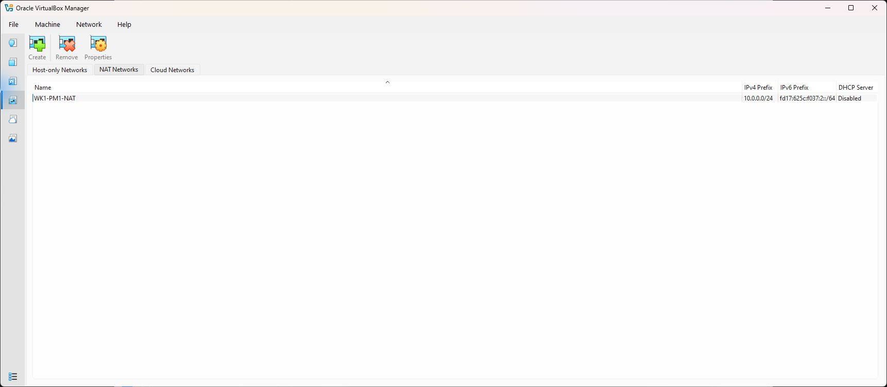
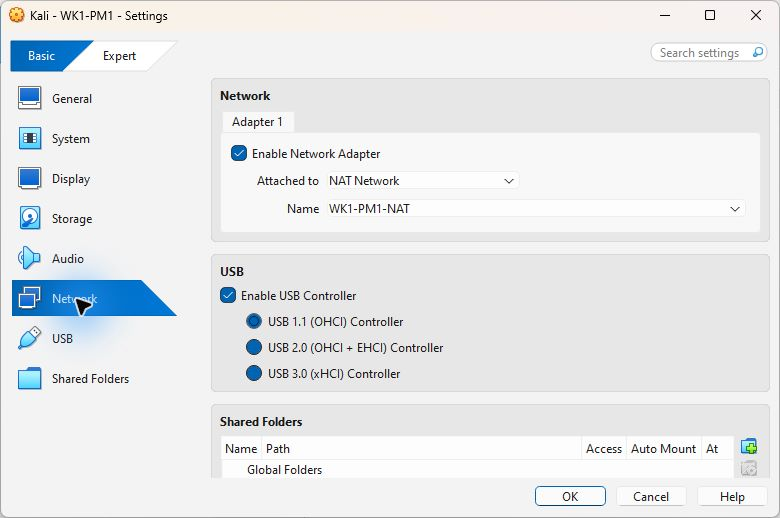
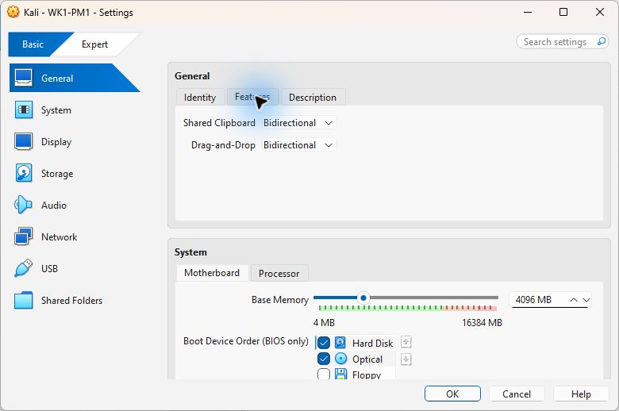
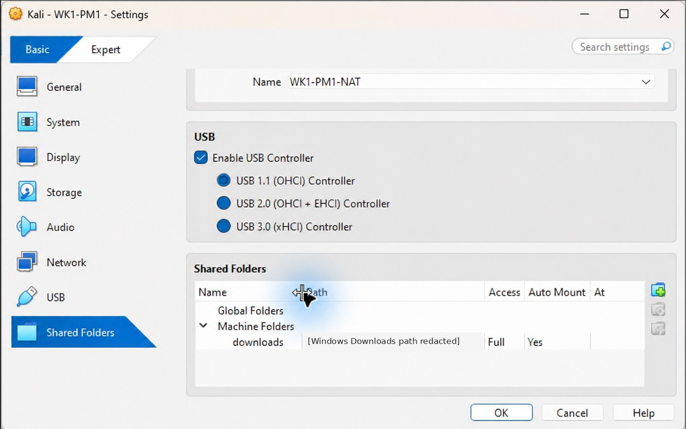
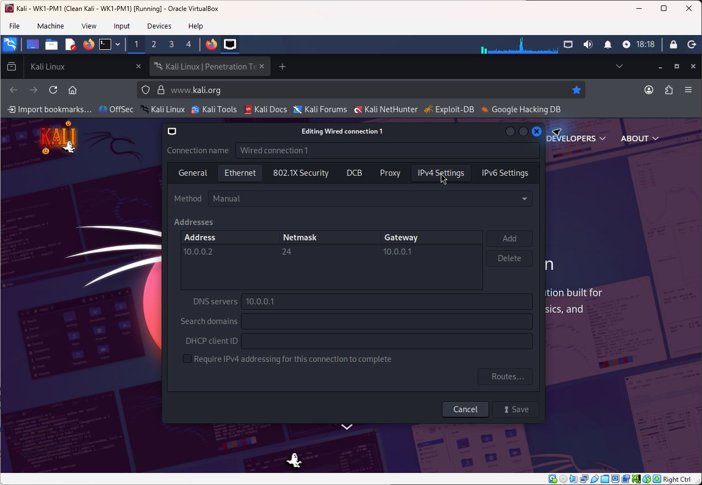
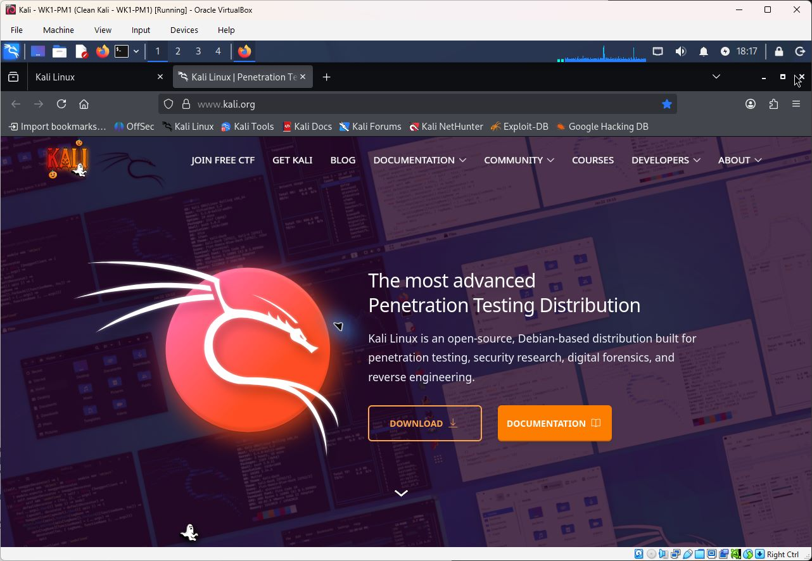
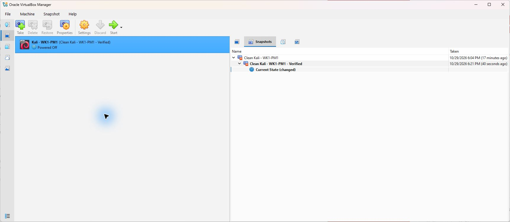

# WK1-PM1 Cybersecurity Lab Setup

**Participant:** Naason Seymour  
**Batch:** B083  
**Project:** Week 1, Project Module 1

## Project Overview

A Kali Linux virtual machine was configured in Oracle VirtualBox on a Windows 11 PC to create a controlled environment for cybersecurity practice. The setup includes a custom NAT Network, a manually assigned IP address, internet connectivity, file sharing between Windows and Kali Linux, and a clean virtual machine snapshot.

The completed Kali VM uses the `10.0.0.0/24` network with the address `10.0.0.2/24`. Connectivity, clipboard sharing, the shared Downloads folder, and snapshot restoration were tested successfully.

## System Configuration

| Component | Configuration |
|---|---|
| Host operating system | Windows 11 Pro, 64-bit |
| Processor | AMD Ryzen 7 3700X, hardware virtualization enabled |
| Host memory | Approximately 16 GB RAM |
| VirtualBox | 7.2.22 r175245 |
| Guest operating system | Kali Linux 2026.3 amd64, prebuilt VirtualBox image |
| VM name | Kali - WK1-PM1 |
| VM resources | 4 GB RAM, 2 CPU cores, VMSVGA, 128 MB video memory |

The VirtualBox installer passed its SHA-256 checksum and Oracle digital-signature checks. The Kali Linux archive checksum also matched the value published on its official download page.

## Network and Integration Settings

| Setting | Configuration |
|---|---|
| NAT Network name | WK1-PM1-NAT |
| Network type | NAT Network |
| Network range | `10.0.0.0/24` |
| Kali IPv4 address | `10.0.0.2/24` (manual) |
| Default gateway | `10.0.0.1` |
| DNS server | `10.0.0.1` |
| DHCP | Disabled for this single-VM setup |
| Promiscuous mode | Allow All |
| Shared clipboard | Bidirectional |
| Drag and drop | Bidirectional |
| Shared folder | Windows Downloads, shared as `downloads` |
| Kali shared-folder mount | `/media/sf_downloads` (automatic mount) |

Only one virtual machine was configured on this NAT Network, so the assigned Kali address does not conflict with another VM in the lab.

## Setup Process

### 1. Install VirtualBox

Installed Oracle VirtualBox on the Windows host and enabled the components needed to run virtual machines.

### 2. Create the NAT Network

Created `WK1-PM1-NAT` with the `10.0.0.0/24` network range.

### 3. Import Kali Linux

Extracted the Kali Linux prebuilt VirtualBox archive and registered the included `.vbox` virtual machine file.

### 4. Configure the Virtual Machine

Allocated 4 GB of RAM and two processor cores, then connected the Kali network adapter to `WK1-PM1-NAT`.

### 5. Enable Clipboard, Drag and Drop, and File Sharing

Set the shared clipboard and drag-and-drop options to **Bidirectional**. Clipboard text transfers were tested successfully from Windows to Kali and from Kali to Windows.

Added the Windows Downloads folder as a permanent shared folder named `downloads` with automatic mounting enabled. A test file created in Windows was opened and edited in Kali, and the updated file was then read from Windows.

The host's personal Windows folder path is obscured in the shared-folder screenshot. The shared-folder name and configuration remain visible.

### 6. Assign the Kali Linux IP Address

Configured the Kali wired connection with a manual IPv4 address of `10.0.0.2/24`, gateway `10.0.0.1`, and DNS server `10.0.0.1`.

### 7. Test Network Connectivity

Verified the Kali IP address and routing, tested gateway reachability, confirmed DNS resolution, and loaded the Kali Linux website through HTTPS in Firefox. Shared-folder read/write operations and bidirectional clipboard transfers also passed.

### 8. Save and Restore a Clean Snapshot

Shut down the VM and created the snapshot **Clean Kali - WK1-PM1**. Restored it and rebooted the guest to verify that the static IP configuration, DNS, HTTPS access, and shared folder still worked. After final tests, shut down the guest and saved **Clean Kali - WK1-PM1 - Verified** as the final baseline.

## Verification Results

| Check | Result |
|---|---|
| Manual IP and default route | Passed |
| Gateway connectivity | Passed |
| DNS resolution | Passed after changing the DNS server to `10.0.0.1` |
| HTTPS connectivity | Passed; website responded with HTTP/2 200 |
| Shared clipboard | Passed in both directions |
| Shared Downloads folder | Read/write test passed in both directions |
| Drag and drop | Enabled in both directions; a separate file-drag test was not performed |
| Snapshot restore | Passed; network access and shared folder remained functional |

Additional results are available in the repository:

- [Network and internet verification](verification.txt)
- [Clipboard transfer verification](clipboard-verification.json)
- [Shared-folder verification](shared-folder-verification.json)
- [Snapshot details](snapshot.txt)
- [Post-restore verification](post-restore-verification.txt)
- [Virtual machine configuration](vm-configuration.txt)

## Troubleshooting

### DNS Resolution

The initial DNS server, `8.8.8.8`, timed out even though Kali could reach the network gateway and an external numeric IP address. A DNS query sent to the NAT gateway at `10.0.0.1` succeeded, indicating that the problem involved DNS resolution rather than general network access.

After changing the DNS server to `10.0.0.1` and reconnecting the wired connection, domain resolution and HTTPS access worked normally.

### VirtualBox Settings Window

The VirtualBox Manager settings window initially stalled. VirtualBox command-line tools were used to apply and verify the configuration. A missing host USB component was installed, and its background service was refreshed to clear a device-discovery warning.

The Settings window later opened normally, allowing the network, clipboard, and shared-folder settings to be captured. The original cause of the window stall was not established.

## Lab Scope

The configuration and connectivity checks were performed in an owned virtual lab environment. No unauthorized systems were scanned or accessed.

## Software Sources

- [Oracle VirtualBox](https://www.virtualbox.org/wiki/Downloads)
- [Kali Linux Virtual Machines](https://www.kali.org/get-kali/#kali-virtual-machines)
- [Kali Linux VirtualBox Import Guide](https://www.kali.org/docs/virtualization/import-premade-virtualbox/)
